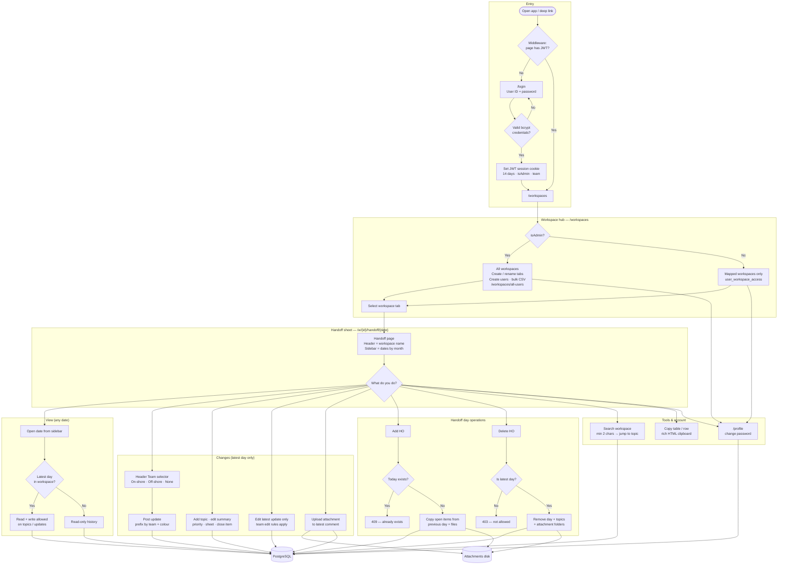
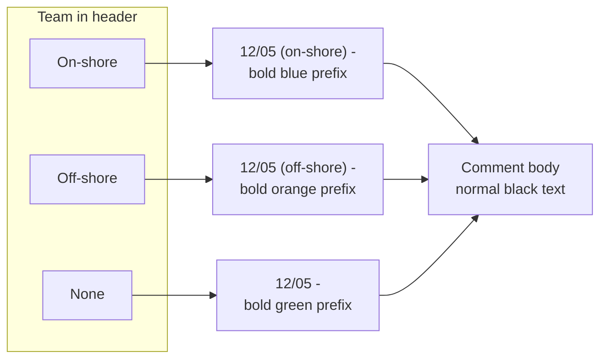

# Handoff Hub — Application flow

End-to-end flow from opening the app through workspace selection to handoff sheet actions.  
For component architecture and API data flows, see [`ARCHITECTURE.md`](ARCHITECTURE.md).

---

## 1. Full application flow

---

## 2. Comment prefix by team (when posting an update)

---

## 3. Route map (main screens)

| Step | Route | Who |
|------|-------|-----|
| Login | `/login` | Everyone |
| Home redirect | `/` → `/workspaces` | Everyone |
| Workspace picker | `/workspaces` | Everyone |
| All users (admin) | `/workspaces/all-users` | Admin |
| Handoff sheet | `/w/{workspaceId}/handoff/{YYYY-MM-DD}` | Everyone with access |
| Profile | `/profile` | Everyone |

---

## 4. Decision rules (quick reference)

| Action | Allowed when |
|--------|----------------|
| Edit topic / post update / upload file | Selected date is the **latest** handoff day in that workspace |
| Edit a comment | That comment is the **latest** on its topic, plus team/author rules |
| Add HO | No handoff row yet for **today** in that workspace |
| Delete HO | Selected date **is** the latest handoff day in that workspace |
| View older dates | Always (read-only for mutations) |

---

## How to view these diagrams

- **GitHub / GitLab** — Mermaid renders in the markdown preview.
- **VS Code / Cursor** — Markdown preview with Mermaid support.
- **Export** — Paste the `mermaid` block into [mermaid.live](https://mermaid.live) to export PNG or SVG.
