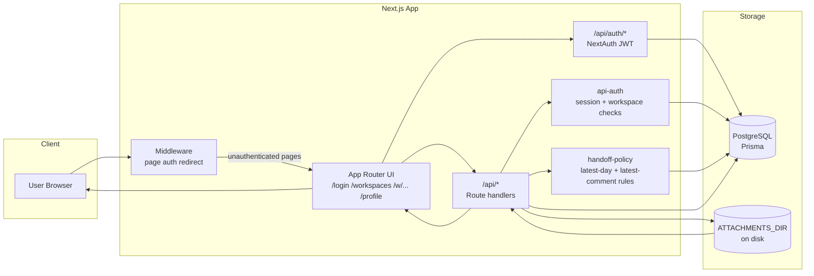
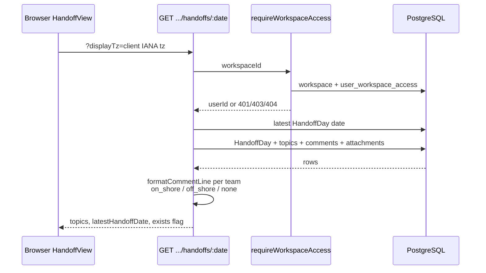
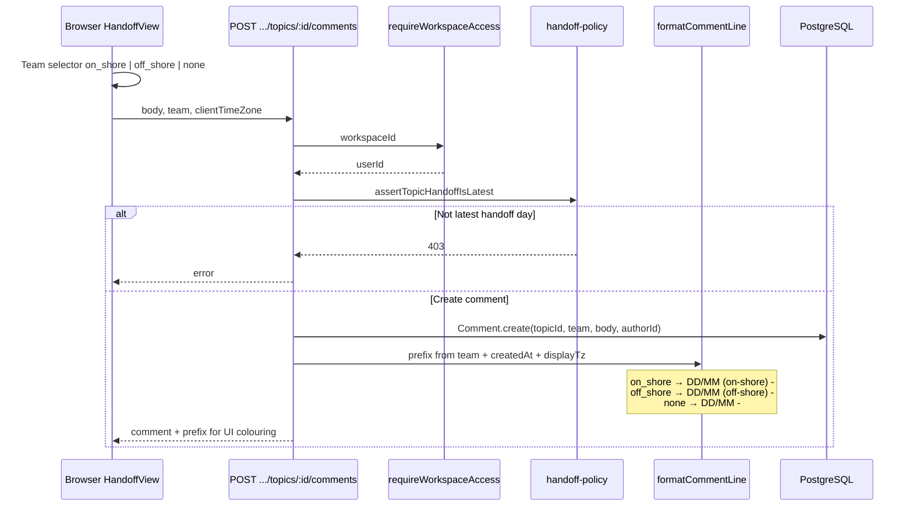
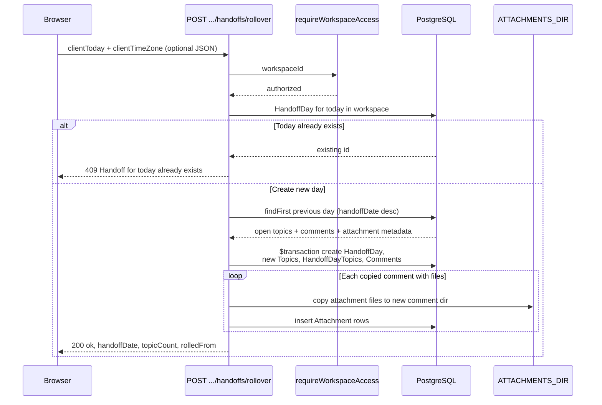
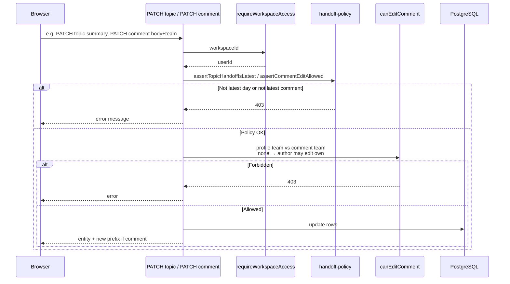
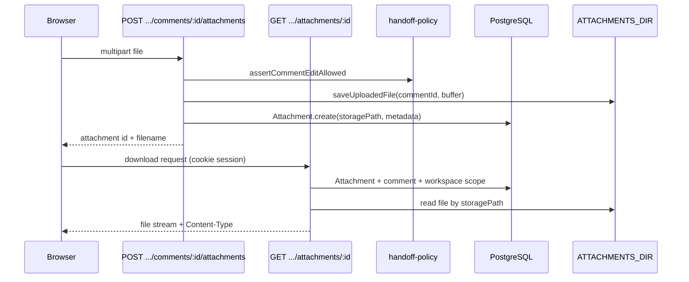
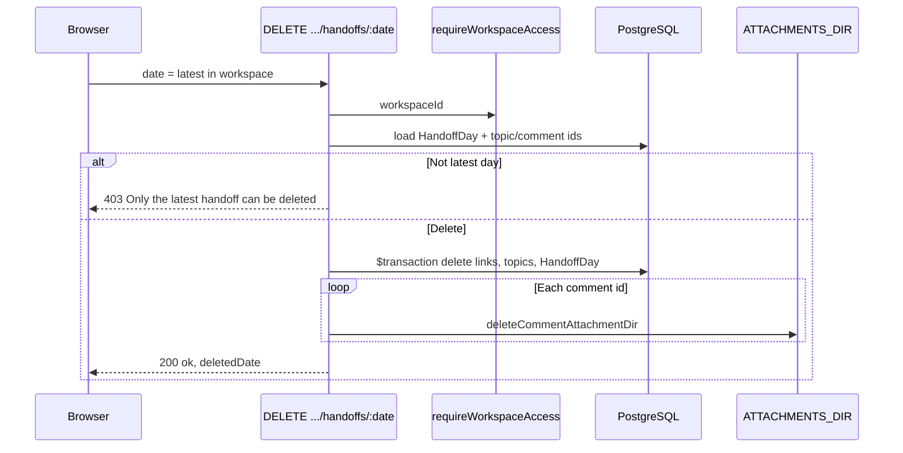
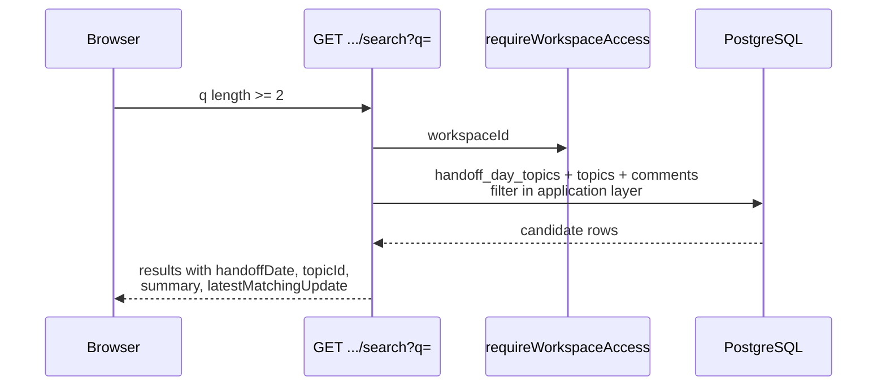

# Handoff App - Flow and Data Architecture

This document explains the end-to-end application flow, data flow, and how the main functionality works.

## 1) What the tool does

The application is a daily handoff board for teams. Work is grouped by **workspace** (for example: FE Production, OMS DEV, Testing).  
Inside each workspace, each calendar date has one handoff sheet with topics, team updates (comments), priorities, optional sheet data, and file attachments.

Core goals:
- Maintain day-wise handoff history per workspace
- Carry forward **open** items into a new day (**Add HO**)
- Post updates as **On-shore**, **Off-shore**, or **None** (distinct date-line prefix and colour)
- Control user access (admin vs one-or-more workspace mappings)
- Search topics and updates across all days in a workspace
- Copy handoff tables to the clipboard (rich HTML for Outlook/Word)
- Keep update history and file evidence on disk

## 2) High-level component flow



## 2.1 Application flow (end-to-end)

See **[`APPLICATION-FLOW.md`](APPLICATION-FLOW.md)** for the full application flow diagram (phased: sign-in → workspaces → handoff sheet → actions), team prefix flow, route map, and decision rules.

```mermaid
flowchart LR
  A[Login] --> B[/workspaces]
  B --> C{Admin?}
  C -->|Yes| D[Manage tabs & users]
  C -->|No| E[Mapped workspaces]
  D --> F[Handoff sheet]
  E --> F
  F --> G[View · Add HO · Edit · Search · Copy]
```

## 3) Full user flow

### A) Login and session
1. Unauthenticated visits to any page (except `/login`, static assets, `/api/auth/*`) are redirected by **middleware** to `/login?callbackUrl=...`.
2. User enters **email (user ID)** + password on `/login`.
3. NextAuth **Credentials** provider loads `User` by email, compares **bcrypt** hash.
4. On success, a **JWT session** cookie is issued (`isAdmin`, `team`, `id` in token) and the user is sent to `callbackUrl` or `/workspaces`.

### B) Workspace picker and authorization
1. `/` redirects to `/workspaces`.
2. UI calls `GET /api/workspaces`.
3. **Admin** (`isAdmin=true`): all workspaces; can `POST` new tabs and `PATCH` rename.
4. **Workspace user**: only workspaces in `user_workspace_access` (supports multiple mappings).
5. Every workspace-scoped API calls `requireWorkspaceAccess(workspaceId)` before read/write.

### C) Handoff day UI
1. Route: `/w/{workspaceId}/handoff/{YYYY-MM-DD}` inside `HandoffShell` + `HandoffSidebar`.
2. Page **header** shows the workspace name only (e.g. `FE Production` — no automatic `Handoff` suffix).
3. `GET /api/workspaces/:id/handoffs/:date?displayTz=...` returns topics, comments (with computed **prefix** per team), attachments metadata, and `latestHandoffDate`.
4. **Mutations** (topics, comments, uploads, close) are allowed only on the **latest** handoff day in that workspace (`handoff-policy`).
5. **Comment edits** are allowed only on the **latest comment** per topic (by `updatedAt` / `createdAt`).
6. **Team edit rule** (`comment-permissions`): users with a profile `team` may edit that team's latest update; authors may edit their own **None** updates; users without a profile team may edit only their own comments.

### C.1) Update teams, prefixes, and colours

Header **Team** selector (persisted in `localStorage`): **On-shore**, **Off-shore**, **None**.

| Team | Prefix example | Prefix style | Comment body |
|------|----------------|--------------|--------------|
| On-shore | `12/05 (on-shore) -` | bold, blue | normal, black |
| Off-shore | `12/05 (off-shore) -` | bold, orange | normal, black |
| None | `12/05 -` | bold, green | normal, black |

Prefixes are built server-side by `formatCommentLine()` using `displayTz` / `HANDOFF_TZ`. Clipboard and mail export use matching colours via `teamMailColor()`.

### D) Add HO and Delete HO
1. **Add HO**: `POST /api/workspaces/:id/handoffs/rollover` with optional JSON `{ clientToday, clientTimeZone }` from the browser; falls back to `HANDOFF_TZ` when omitted.
2. If today's `HandoffDay` already exists for that workspace → **409**.
3. Otherwise copies **open** topics from the **most recent earlier** day, including comments and attachment files.
4. **Delete HO**: `DELETE /api/workspaces/:id/handoffs/:date` only when `date` equals the workspace's latest day; cascades DB rows and removes attachment directories from disk.

### E) Search and navigation
1. In-handoff search calls `GET /api/workspaces/:id/search?q=...` (min 2 characters).
2. Results link to `/w/.../handoff/{date}?focusTopic=...&q=...` to scroll/highlight matches.

### F) Clipboard export
1. **Copy handoff** / **Copy row** builds HTML + plain text client-side (`cf-html-clipboard`).
2. Rich paste targets Outlook, Word, and OneNote; long-press copy can limit to latest update per item.

### G) User management (admin)
1. `/workspaces`: create user (`POST /api/users`) with `admin` or `workspace` access (single or multiple `workspaceIds`).
2. **Bulk import**: download template / upload CSV via `GET|POST /api/users/bulk`.
3. `/workspaces/all-users`: list, edit, delete users (`GET|PATCH|DELETE /api/users/:id`).

### H) Profile
1. `/profile` → `PATCH /api/users/password` with current + new password (bcrypt update).

## 4) Data flow diagrams

### 4.1 Authentication and session

```mermaid
sequenceDiagram
  participant B as Browser
  participant L as /login UI
  participant NA as /api/auth/* NextAuth
  participant DB as PostgreSQL

  B->>L: POST credentials
  L->>NA: signIn(email, password)
  NA->>DB: User.findUnique(email)
  DB-->>NA: passwordHash, isAdmin, team
  NA->>NA: bcrypt.compare
  alt Invalid
    NA-->>L: null
    L-->>B: error on login form
  else Valid
    NA-->>B: Set JWT session cookie
    B->>B: Redirect to /workspaces or callbackUrl
  end

  Note over B,NA: Subsequent API calls send cookie;<br/>auth() reads JWT; middleware guards pages only
```

### 4.2 Load handoff day (read path)



### 4.3 Post comment (with team)



### 4.4 Add HO (rollover)



### 4.5 Topic / comment mutation (write path)



### 4.6 Attachment upload and download



### 4.7 Delete HO (latest day)



### 4.8 Workspace search



## 5) Where data is stored

### PostgreSQL tables (core)
| Table / model | Purpose |
|---------------|---------|
| `User` | Login email, bcrypt `password_hash`, optional `contact_email`, `team`, `is_admin` |
| `Workspace` | Tab name and `sort_order` |
| `user_workspace_access` | Many-to-many: non-admin users → workspaces |
| `HandoffDay` | One row per `(workspace_id, handoff_date)` |
| `Topic` | Summary, short summary, owner, `priority`, `sheet_data` JSON, closed state |
| `handoff_day_topics` | Topic membership and sort order for a day |
| `comments` | Updates per topic; `team` enum: `on_shore`, `off_shore`, `none` |
| `attachments` | File metadata; `storage_path` points to disk |

### Filesystem
- Uploaded files under `ATTACHMENTS_DIR` (default `./data/attachments`), organized per comment
- DB stores path + filename + mime + size; bytes live on disk
- Rollover **copies** files; delete HO **removes** comment attachment directories

### Session
- NextAuth **JWT** strategy (httpOnly cookie, 14-day `maxAge`)
- API routes rely on `auth()` per request; middleware only protects **pages**, not `/api/*`

## 6) Access model summary

| Capability | Admin | Workspace user |
|------------|-------|----------------|
| All workspaces | Yes | Mapped only (can be multiple) |
| Create / rename workspace tabs | Yes | No |
| Create / bulk / manage users | Yes | No |
| View `/workspaces/all-users` | Yes | No |
| Handoff read (any date in scope) | Yes | Yes |
| Handoff write (latest day only) | Yes | Yes |
| Profile / change own password | Yes | Yes |

## 7) Functionality summary

The handoff app supports controlled daily operational tracking per workspace. Each workspace keeps an independent dated history of topics and team updates, with **On-shore**, **Off-shore**, and **None** prefixes for visual distinction. **Add HO** rolls open work forward from the previous day and copies evidence files. **Delete HO** removes only the newest sheet when mistakes happen. **Search** and deep links (`focusTopic`, `q`) help find items across history. **Role-based access** separates global admins from workspace-scoped users. Server-side checks (`requireWorkspaceAccess`, `handoff-policy`, `comment-permissions`) enforce scope and edit rules; passwords are bcrypt-hashed; attachments are stored on disk with metadata in PostgreSQL.

For Perforce depot setup and post-sync commands, see [`PERFORCE.md`](PERFORCE.md).
