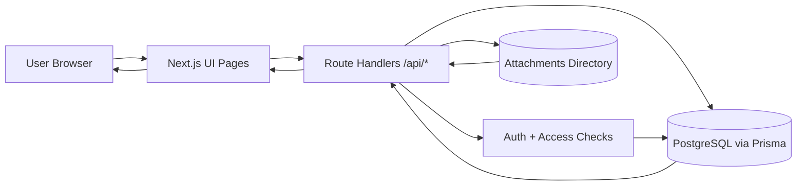
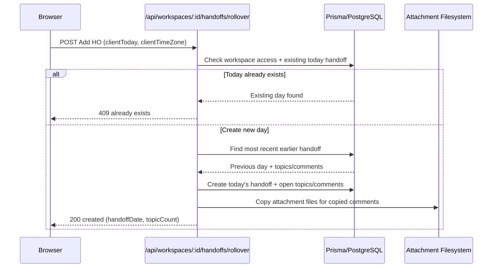

# Handoff App - Flow and Data Architecture

This document explains the end-to-end tool flow, data flow, and how the main functionality works.

## 1) What the tool does

The application is a daily handoff board for teams. Work is grouped by **workspace** (for example: FE Production, OMS DEV, Testing).  
Inside each workspace, each date has one handoff sheet with topics, updates, and attachments.

Core goals:
- Maintain day-wise handoff history per workspace
- Carry forward open items into a new day (Add HO)
- Control user access (admin vs workspace-specific)
- Keep update history and file evidence

## 2) High-level component flow



## 2.1 End-to-end workflow diagram

```mermaid
flowchart TD
  A[Open App] --> B[Login with User ID + Password]
  B --> C{Credentials valid?}
  C -- No --> B
  C -- Yes --> D{isAdmin?}

  D -- Yes --> E[Show all workspaces]
  D -- No --> F[Show mapped workspace(s) only]

  E --> G[Open workspace handoff page]
  F --> G

  G --> H{User action}
  H --> I[View handoff history]
  H --> J[Add HO]
  H --> K[Add/Edit topic or update]
  H --> L[Upload attachment]
  H --> M[Profile: change password]

  J --> N{Today's HO exists?}
  N -- Yes --> O[Return 409 already exists]
  N -- No --> P[Copy open items from latest earlier HO]
  P --> Q[Create today's HO]

  I --> R[(PostgreSQL)]
  K --> R
  J --> R
  M --> R
  L --> S[(Attachments on Disk)]
  L --> R
```

## 3) Full user flow

### A) Login and session
1. User enters user ID + password on `/login`.
2. Credentials provider validates against `User` table.
3. Password comparison uses bcrypt hash.
4. On success, JWT session is issued and user is redirected.

### B) Workspace visibility and authorization
1. UI calls `GET /api/workspaces`.
2. If user is admin (`isAdmin=true`), API returns all workspaces.
3. If user is non-admin, API returns only workspaces mapped in `user_workspace_access`.
4. All workspace APIs enforce access checks before read/write operations.

### C) Handoff day operations
1. Open page: `/w/{workspaceId}/handoff/{YYYY-MM-DD}`.
2. API fetches handoff for selected date with topics/comments/attachments metadata.
3. Mutations are restricted to latest handoff day in that workspace.
4. Add HO:
   - Creates handoff for today if missing
   - Copies only open items from the **most recent earlier handoff** in that workspace
   - Returns 409 if today handoff already exists

### D) User management (admin)
1. Admin opens workspaces page and creates new user.
2. Admin picks access level:
   - `admin` -> full access
   - `workspace` -> mapped to selected workspace
3. User is created with bcrypt password hash; mapping row stored for workspace users.

### E) Profile and password change
1. User opens `/profile`.
2. App shows own username.
3. User enters current + new + confirm password.
4. API validates current password hash and updates stored hash.

## 4) Data flow for Add HO



## 5) Where data is stored

### PostgreSQL tables (core)
- `User` - login ID, password hash, admin flag, profile fields
- `Workspace` - workspace master list
- `user_workspace_access` - mapping for workspace-specific users
- `HandoffDay` - one row per workspace/date
- `Topic` - topic content/state
- `handoff_day_topics` - topic ordering inside a handoff day
- `comments` - updates posted per topic/team/author
- `attachments` - file metadata and storage path

### Filesystem
- Real uploaded files are stored under `ATTACHMENTS_DIR` (default `./data/attachments`)
- DB stores `attachments.storage_path`; file content lives on disk

### Session
- Auth session uses NextAuth JWT strategy (cookie-based token)

## 6) Access model summary

- **Admin user**
  - Access to all workspaces/handoffs
  - Can create and rename workspace tabs
  - Can create users and assign access

- **Workspace user**
  - Access only to mapped workspace(s)
  - Can work only within authorized workspace scope
  - Sees profile entry instead of admin home shortcut

## 7) Small functionality write-up

The handoff app is designed for controlled daily operational tracking. Each workspace maintains independent day-by-day handoff sheets, with topics and updates that preserve context and auditability. The Add HO action reduces manual effort by carrying open work from the latest previous handoff into today. Role-based access ensures admins can manage global setup while workspace users only see permitted handoffs. Passwords are securely hashed, file uploads are stored on disk with DB metadata, and all business actions are enforced through server-side workspace authorization checks.
